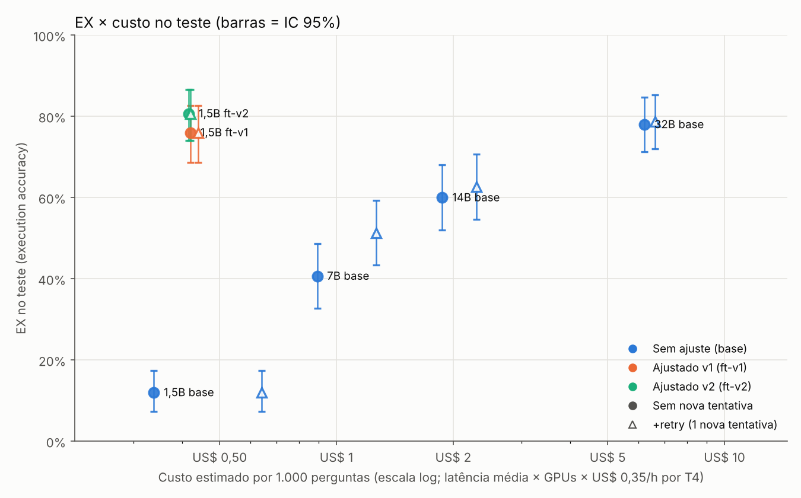
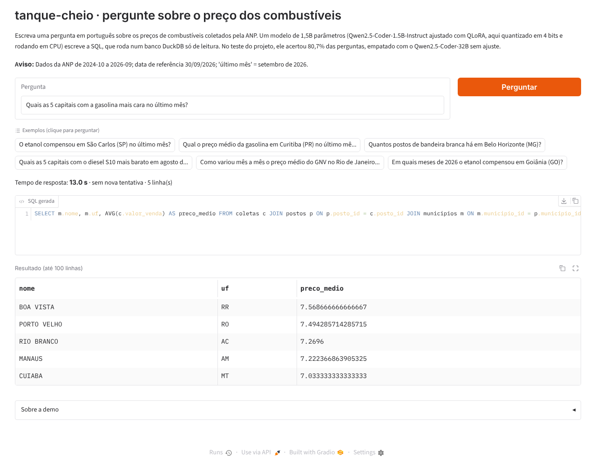
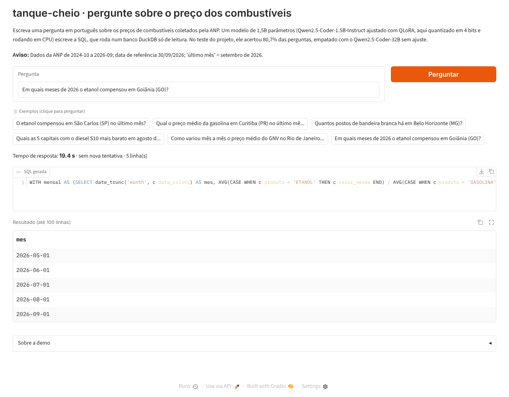

# tanque-cheio

[](https://github.com/belasoaress/tanque-cheio/actions/workflows/ci.yml)

Portuguese text-to-SQL over Brazil's ANP fuel price data (DuckDB), with Qwen2.5-Coder-1.5B fine-tuned via QLoRA on Kaggle's free T4.
On a hand-reviewed 150-question test set, the fine-tuned 1.5B reaches 80.7% execution accuracy (95% CI 74.0–86.7%), statistically tied with the untuned Qwen2.5-Coder-32B (78.0%, McNemar p = 0.63) and 20.7 points above the untuned 14B, with ~7× lower latency and ~15× lower GPU cost per question.
Total API spend: US$ 0; every number below is recomputed by CI from saved predictions.

---

O tanque-cheio recebe uma pergunta em português sobre preços de combustíveis no Brasil
("Em quais capitais o etanol compensou em todos os meses de 2025?"), gera uma consulta SQL,
executa-a com segurança sobre um snapshot dos dados da ANP e devolve a tabela, com a SQL
visível. O modelo é o Qwen2.5-Coder-1.5B-Instruct, pequeno o bastante para rodar numa GPU
barata, ajustado com QLoRA.

A pergunta da v2 foi: quanto um modelo pequeno e ajustado chega perto de modelos muito
maiores, e a que custo?

**Resultado principal.** No teste de 150 perguntas, o 1,5B ajustado (v2) acerta
**80,7%** (IC 95%: 74,0–86,7%). O Qwen2.5-Coder-32B sem ajuste, 21 vezes maior, acerta
78,0% (IC 71,3–84,7%). A diferença de 2,7 p.p. não é significativa (McNemar p = 0,63:
21 perguntas só o 1,5B acerta, 17 só o 32B), então leio como **empate estatístico**.
Contra o 14B sem ajuste (60,0%), a vantagem é de 20,7 p.p. (p < 0,001). E o 1,5B faz
isso com ~7× menos latência (p50 de 4,3 s contra 29,1 s), 1 GPU T4 em vez de 2, ~1/7 da
memória de GPU (3,1 GiB contra ~21 GiB somando as 2 GPUs do 32B) e ~15× menos custo por
pergunta (US$ 0,42 contra US$ 6,22 por 1.000). Sem ajuste, o mesmo 1,5B acerta só
12,0%. Custo de API: US$ 0. O treino usou a GPU grátis do Kaggle (~3,5 h na v1 e ~5,3 h
na v2).

Os grandes rodaram em 4 bits (nf4), porque é o que cabe nas GPUs grátis. Os números
deles são um piso: em fp16 talvez fizessem alguns pontos a mais.



## Resultados

Teste com 150 perguntas (50 fáceis, 60 médias, 40 difíceis), escritas e revisadas à mão,
isoladas do treino. EX = execution accuracy: a SQL gerada é executada e o resultado tem de
bater com o da SQL de referência. EX tolerante aceita colunas a mais na resposta (D28).
Os números são cópia de [`results/report.md`](results/report.md), gerado por
`uv run tanque eval report` (sistemas sem nova tentativa):

| Sistema | EX | IC 95% EX | EX tolerante | EX fácil | EX médio | EX difícil | SQL válida | p50 (ms) | GPUs | Pico GPU (GiB) | US$ / 1.000 |
|---|---|---|---|---|---|---|---|---|---|---|---|
| `base-qwen2.5-coder-1.5b-instruct` | 12,0% | 7,3–17,3% | 12,7% | 28,0% | 6,7% | 0,0% | 22,0% | 3.087 | 1 | 3,1 | 0,3384* |
| `base-qwen2.5-coder-7b-instruct` | 40,7% | 32,7–48,7% | 46,0% | 28,0% | 70,0% | 12,5% | 62,7% | 8.800 | 1 | 5,8 | 0,8919* |
| `base-qwen2.5-coder-14b-instruct` | 60,0% | 52,0–68,0% | 63,3% | 62,0% | 81,7% | 25,0% | 87,3% | 16.228 | 1 | 10,2 | 1,8745* |
| `base-qwen2.5-coder-32b-instruct` | 78,0% | 71,3–84,7% | 82,7% | 96,0% | 90,0% | 37,5% | 96,7% | 29.052 | 2 | 10,7 | 6,2203* |
| `ft-qwen2.5-coder-1.5b-instruct` (v1) | 76,0% | 68,7–82,7% | 84,0% | 98,0% | 76,7% | 47,5% | 96,7% | 4.259 | 1 | 3,1 | 0,4206* |
| **`ft2-qwen2.5-coder-1.5b-instruct` (v2)** | **80,7%** | 74,0–86,7% | 85,3% | 92,0% | 83,3% | 62,5% | 98,7% | 4.268 | 1 | 3,1 | 0,4165* |

\* Custo estimado: latência média × US$ 0,35 por hora de uma GPU T4 sob demanda no Google
Cloud, por GPU (o 32B usa 2). Só a GPU, sem a VM: é um piso. No Kaggle não custou nada.
Pico GPU = maior memória numa GPU (no 32B, em cada uma das 2).

Com uma nova tentativa depois de um erro (D32), o 7B sobe para 51,3% (+10,7 p.p.,
p < 0,001), o 14B para 62,7% e o 32B para 78,7%. Os ajustados não mudam (80,7% e
76,0%): quase não geram SQL inválida. A tabela completa, com e sem nova tentativa, está
no relatório.

Comparações pareadas do ft-v2 no teste (McNemar exato, pergunta a pergunta):

| Contra | EX dele | Δ EX | Só o ft-v2 acerta | Só o outro acerta | p |
|---|---|---|---|---|---|
| 32B sem ajuste | 78,0% | +2,7 p.p. | 21 | 17 | 0,63 |
| ft-v1 | 76,0% | +4,7 p.p. | 11 | 4 | 0,12 |
| 14B sem ajuste | 60,0% | +20,7 p.p. | 47 | 16 | < 0,001 |
| 1,5B sem ajuste | 12,0% | +68,7 p.p. | 105 | 2 | < 0,001 |

Onde o ft-v2 ganha e perde: no difícil acerta 62,5%, contra 37,5% do 32B. No fácil caiu
para 92,0%, contra 98,0% do ft-v1.

Todos os sistemas rodaram no Kaggle, numa T4 (o 32B em 2), com o mesmo prompt,
decodificação gulosa e `max_new_tokens = 384`. Nos ajustados, o adapter LoRA foi fundido
no modelo base (fp16) antes de gerar, para a latência ser comparável. O relatório tem
também os 29 erros do ft-v2 por tipo, 10 exemplos comentados e os números do dev e do
dev2.

## v1 → v2

A v1 (M0–M8) levou o 1,5B de 12% para 76% no teste. A v2 mudou seis coisas:

| Mudança | O que rendeu |
|---|---|
| Avaliação com EX tolerante, IC 95% e McNemar (M12) | Agora dá para separar diferença de ruído. Com 150 perguntas, a margem é de ~±7 p.p. |
| Dev ampliado de 50 para 113 perguntas, o dev2 (M13) | Decisões com margem de ~±8 p.p. em vez de ±13 |
| Limite de 384 tokens em vez de 256 | Nenhuma SQL dos ajustados chega mais ao limite (a maior tem 282 tokens), mas a EX do ft-v1 no teste ficou igual: 76,0% |
| Uma nova tentativa depois de erro (M16) | +10,7 p.p. no 7B (p < 0,001); +2,7 no 14B e +0,7 no 32B, sem significância; zero nos ajustados |
| Treino v2: 17 intenções novas, 10.448 pares (M15) | No teste, 76,0% → 80,7% (+4,7 p.p., p = 0,12). Difícil 47,5% → 62,5%, médio 76,7% → 83,3%, fácil 98,0% → 92,0% |
| Comparação com o 7B, o 14B e o 32B sem ajuste (M14, M17) | A história deste README |

**A lição do dev2.** No dev2, o ft-v2 acertava 96,5%. No teste, 80,7%. A queda de ~16
p.p. é sobreajuste ao dev2: desenhei os templates novos a partir dos erros do ft-v1 no
dev2. O filtro de vazamento barra perguntas quase iguais, mas não o mesmo padrão. O
plano já previa um número otimista, e por isso o teste ficou fechado até o fim.

**O ganho do v2 sobre o v1 não é significativo.** São +4,7 p.p. (11 perguntas só o v2
acerta, 4 só o v1), com p = 0,12. Com 150 perguntas, não dá para afirmar que o v2 é
melhor. O v1 já empatava com o 32B (76,0% contra 78,0%, p = 0,74). O v2 melhora onde o
treino mirou (difícil e médio) e perde um pouco no fácil.

## Como rodar

Pré-requisito: [uv](https://docs.astral.sh/uv/). Os comandos são os mesmos no Windows
(PowerShell), Linux e macOS.

```
uv sync
uv run tanque data build --from-parquet snapshot/coletas-2026-09.parquet
uv run tanque eval report
```

O primeiro instala o ambiente. O segundo monta o banco DuckDB (`data/tanque.duckdb`) a
partir do snapshot versionado no repositório, sem baixar nada, e confere o SHA-256 e cada
tabela contra o registro original. O terceiro recalcula o relatório a partir das previsões
salvas. Para conferir tudo do jeito que o CI confere:

```
uv run tanque eval check-metrics
uv run tanque eval report --check
uv run tanque eval chart --check
uv run pytest -q
```

Para desenhar o gráfico de novo: `uv sync --group chart` e `uv run tanque eval chart`.

Outros comandos úteis: `uv run tanque data build` (refaz tudo a partir dos 48 CSVs da ANP),
`uv run tanque eval score datasets/test.jsonl <previsões>.jsonl`,
`uv run tanque gen templates --n 13000 --seed 42` (regera o treino v2) e
`uv run tanque --help`. A inferência e o treino rodam em GPU, nos notebooks do Kaggle
(`notebooks/`, com os passos em [`notebooks/README.md`](notebooks/README.md)); o CI não
roda modelos. Para usar o adapter direto, veja o exemplo no card do
[adapter v2](https://huggingface.co/belasoares/tanque-cheio-qwen2.5-coder-1.5b-lora-v2).

## Demo

O modelo final (ft-v2), fundido e quantizado em GGUF Q4_K_M (~0,9 GB), roda em CPU, sem
GPU. A demo é um app Gradio (`app/`) que usa o mesmo prompt, o mesmo guardrail e a mesma
nova tentativa da avaliação. Numa CPU de 4 núcleos, as perguntas de exemplo levam de 6 a
21 s.





Ela está publicada no Hugging Face Spaces, em
[belasoares/tanque-cheio](https://huggingface.co/spaces/belasoares/tanque-cheio), na CPU
grátis. Essa CPU tem cota de uso por conta, e quando a cota acaba o Space fica pausado. Para
rodar no seu computador, siga [`docs/demo.md`](docs/demo.md), seção "Rodar o app no seu
computador".

## Arquitetura

Dados e treino:

```
CSVs mensais da ANP ──► download ──► normalize ──► snapshot/coletas-2026-09.parquet (commitado)
                                                              │
                                                    build ──► data/tanque.duckdb (3 tabelas)
                                                              │
  templates (57 intenções) + valores reais do banco ──► filtro de vazamento ──► datasets/train.jsonl
```

Avaliação da v2:

```
dev2 (113) ──► decisões (templates v2, hiperparâmetros, prompt de correção)
                                   │
train v2 = train v1 + templates novos ──► Kaggle QLoRA ──► ft-v2 (HF)
                                   │
sistemas: base-1.5B · ft-v1 · ft-v2 · base-7B · base-14B · base-32B
   │  mesmo prompt único, gulosa, 384 tokens, 4 bits nos grandes
   ├─► previsão ──► guard/execute ──► erro? ──► 1 nova tentativa com o erro (D32)
   ▼
métricas (EX rígida/tolerante, IC, McNemar, latência, memória, custo) ──► report v2
                                   │
ft-v2 fundido ──► GGUF Q4_K_M ──► HF Spaces (CPU) ──► demo
```

- `src/tanque/data/`: download, normalização, build do banco e do snapshot.
- `src/tanque/sql/`: guardrail e execução segura.
- `src/tanque/prompting.py`: o prompt único, igual para todos os sistemas.
- `src/tanque/gen/`: geração do treino por templates, validação e filtro de vazamento.
- `src/tanque/train/` e `src/tanque/infer/`: fine-tuning e previsões, usados pelos
  notebooks. `infer/repair.py` é a nova tentativa; `infer/large.py`, os modelos em 4 bits.
- `src/tanque/eval/`: comparador, métricas, IC e McNemar (`stats.py`), relatório e
  gráfico.
- `datasets/`: treino, dev, dev2 e teste. `results/`: previsões, métricas e relatórios.

## Decisões e trade-offs

**Da v1** (D1 a D25, em [`docs/plan-v1.md`](docs/plan-v1.md)):

- **DuckDB (D4).** Roda dentro do processo, lê Parquet direto e não precisa de servidor. O
  mesmo banco funciona no notebook, no CI e numa demo.
- **Nomes de tabela e coluna em português (D13).** `coletas`, `valor_venda`, `municipios`.
  A pergunta é em português; com o schema no mesmo idioma o modelo tem menos tradução para
  fazer.
- **Data de referência fixa (D14, D19).** O snapshot vai até 30/09/2026, então "último
  mês" é setembro de 2026, não o mês de hoje. A data e a regra entram no prompt.
- **Convenções de resposta no prompt (D22).** O comparador exige as mesmas colunas. Sem
  dizer ao modelo que preço médio é `AVG(valor_venda)`, que "gasolina" é a comum e quais
  colunas devolver, respostas razoáveis contariam como erro para todos os sistemas.
- **Treino por templates, sem API paga (D23, D24).** Cada intenção tem um template de SQL
  e várias redações de pergunta, preenchidos com valores reais do banco. A SQL sai certa
  por construção e o custo é zero. O preço é a variedade: as perguntas do treino seguem
  os templates.
- **Snapshot commitado (D25).** O Parquet tem 2,4 MB e fica no repositório, com o SHA-256
  e a contagem + MD5 de cada tabela. O CI reconstrói o banco em ~10 s, sem download.

**Da v2** (D26 a D37, em [`plan.md`](plan.md)):

- **Comparar com modelos maiores da mesma família (D26).** O 7B, o 14B e o 32B do
  Qwen2.5-Coder, sem ajuste, com o mesmo prompt e a mesma decodificação. Mesmo tokenizer
  e mesma licença (Apache-2.0): o que muda é só o tamanho e o ajuste.
- **Grandes em 4 bits (D27).** É o que cabe nas T4 grátis: o 7B e o 14B numa, o 32B em
  duas. Isso pode tirar alguns pontos deles, e eu declaro.
- **Duas métricas, uma principal (D28).** A EX rígida continua sendo a principal. A
  tolerante, definida antes de ver os resultados, mostra quantos erros são só colunas a
  mais.
- **Intervalo de confiança e teste pareado (D29).** Bootstrap com 10.000 reamostragens
  para o IC e McNemar para comparar dois sistemas nas mesmas perguntas. É o que permite
  dizer "empate" com honestidade.
- **Dev maior para decidir (D30).** O dev2 junta o dev da v1 e a reserva, revisados por
  mim: 113 perguntas.
- **384 tokens para todos (D31).** Na v1, 4 erros eram SQLs cortadas no limite de 256.
- **Uma nova tentativa, igual para todos (D32).** Se a SQL é bloqueada ou dá erro, o
  modelo recebe a mensagem e tenta mais uma vez. O relatório mostra com e sem.
- **Teste reaberto, uma vez por sistema (D33).** O teste já tinha sido usado na v1. Na
  v2 ele rodou de novo para os sistemas novos, e o base e o ft-v1 foram refeitos com as
  regras da v2. Toda decisão da v2 veio do dev2.
- **Treino v2 mirando os erros do dev2 (D34).** Templates novos para posição em ranking,
  acumulado, "tanto em X quanto em Y", "todos os …", participação percentual, região ×
  estado, mais reforço das convenções de colunas.
- **Custo pela mesma régua (D35).** Latência média × preço por hora da T4 (US$ 0,35; 2
  T4 = US$ 0,70). Não é o que se pagaria numa API, mas compara os sistemas de forma
  justa.
- **Demo em CPU grátis (D36).** O ft-v2 fundido e convertido para GGUF Q4_K_M, no HF
  Spaces (M19).
- **Ordem de corte (D37).** Se faltasse cota de GPU, sairia primeiro o 32B. Não faltou.

## Limitações

- **Grandes em 4 bits:** o 7B, o 14B e o 32B rodaram em nf4. Os números deles são um
  piso; em fp16 o 32B poderia passar do ft-v2.
- **150 perguntas:** o IC de 95% tem ~±7 p.p. Diferenças de poucos pontos, como ft-v2 ×
  32B e ft-v2 × ft-v1, não são significativas.
- **Teste reaberto na v2 (D33):** o teste foi usado uma vez na v1 e outra na v2. Nenhuma
  decisão saiu dele, mas ele não é mais virgem.
- **Avaliação feita pelo próprio projeto:** as perguntas de dev, dev2 e teste foram
  rascunhadas com ajuda de um agente de código e revisadas por mim, uma a uma. Estão
  isoladas do treino por código, mas seguem as mesmas convenções de resposta, o que
  favorece os ajustados.
- **Treino sintético por templates:** o modelo aprendeu as redações dos templates.
  Perguntas fora desse estilo tendem a sair piores.
- **Regressão no fácil:** o ft-v2 acerta 92,0% das fáceis, contra 98,0% do ft-v1.
- **Uma só seed:** cada treino rodou uma vez (seed 42). Não sei quanto o resultado varia
  de uma rodada para outra.
- **Perguntas difíceis ainda erram:** 62,5% de EX. Os erros mais comuns do ft-v2 são a
  forma do resultado (colunas a mais ou a menos) e a lógica.
- **Snapshot fixo:** coletas de outubro de 2024 a setembro de 2026. Os preços não são
  atualizados.
- **Só combustíveis automotivos** (gasolina, gasolina aditivada, etanol, diesel, diesel S10,
  GNV). Nada de GLP nem de volumes de venda. **Só português.**
- **Latência:** 4,3 s de mediana numa T4. Em CPU seria bem mais lento.
- **Sem comparação com um LLM de fronteira** (D24): sem crédito de API.

## Links

- Demo (Hugging Face Spaces, CPU grátis; pode estar pausada por cota):
  <https://huggingface.co/spaces/belasoares/tanque-cheio>
- Modelo final em GGUF Q4_K_M (Hugging Face):
  <https://huggingface.co/belasoares/tanque-cheio-qwen2.5-coder-1.5b-gguf>
- Adapter v2 (Hugging Face):
  <https://huggingface.co/belasoares/tanque-cheio-qwen2.5-coder-1.5b-lora-v2>
- Adapter v1 (Hugging Face):
  <https://huggingface.co/belasoares/tanque-cheio-qwen2.5-coder-1.5b-lora>
- Notebook do fine-tuning v1 (Kaggle, público):
  <https://www.kaggle.com/code/belasoares/tanque-cheio-finetune>. Os kernels do treino
  v2, dos modelos grandes e do teste final (`tanque-cheio-finetune-v2`,
  `tanque-cheio-large`, `tanque-cheio-final-v2a` e `-v2b`) são privados por enquanto; os
  notebooks estão em [`notebooks/`](notebooks/).
- Dataset (Hugging Face, snapshot + treino/dev/teste): ainda a publicar, em
  `belasoares/tanque-cheio`.
- Relatório final: [`results/report.md`](results/report.md) · modelos maiores no dev2:
  [`results/large-baselines.md`](results/large-baselines.md) · treino v2:
  [`results/training-v2.md`](results/training-v2.md) · treino v1:
  [`results/training.md`](results/training.md) · bake-off dos modelos base:
  [`results/bakeoff.md`](results/bakeoff.md) · schema do banco:
  [`docs/schema.md`](docs/schema.md)
- Plano do projeto: [`plan.md`](plan.md) (v2) e [`docs/plan-v1.md`](docs/plan-v1.md) (v1)

## Licença e dados

O código está sob a [licença MIT](LICENSE).

Os dados de preços são da **Agência Nacional do Petróleo, Gás Natural e Biocombustíveis
(ANP)**, da
[Série Histórica de Preços de Combustíveis](https://www.gov.br/anp/pt-br/centrais-de-conteudo/dados-abertos/serie-historica-de-precos-de-combustiveis),
publicada como dados abertos. Eles **não** estão sob a licença MIT: seguem a licença de
dados abertos indicada pela ANP. Ainda não confirmei o campo de licença no dados.gov.br;
os detalhes estão no card do dataset ([`hf/dataset/README.md`](hf/dataset/README.md)).
Ao reusar, cite a ANP como fonte. O snapshot em `snapshot/` é uma seleção normalizada
desses dados feita por este projeto, não uma publicação oficial da ANP.
